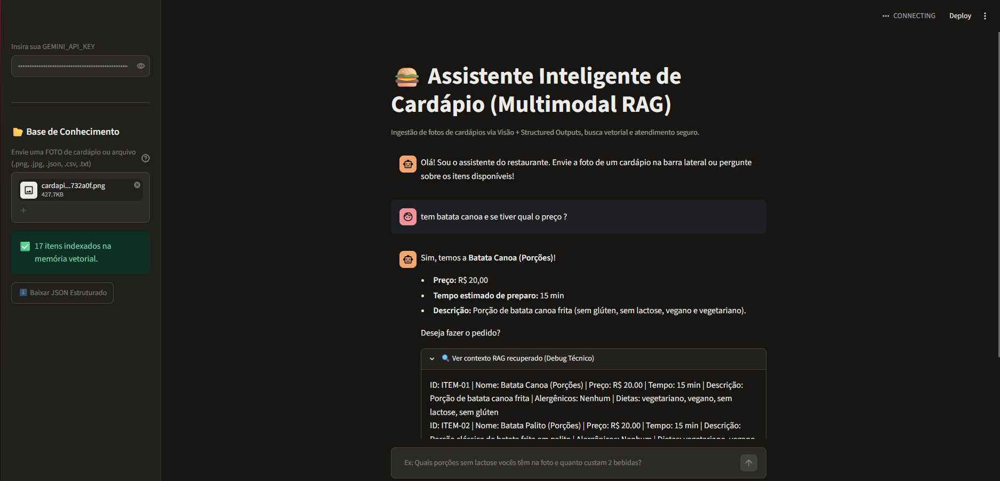

# 🍔 Assistente Inteligente de Cardápio (RAG Pipeline)



Agente conversacional baseado em **Retrieval-Augmented Generation (RAG)** desenvolvido para auxiliar clientes na descoberta de pratos, filtragem rigorosa de alergênicos/restrições alimentares e simulação de orçamento em tempo real.

## 🏗️ Arquitetura da Solução

```text
[Pergunta do Usuário]
        │
        ▼
[Embedding Query (gemini-embedding-001)] ──► [Busca por Similaridade de Cosseno (NumPy)]
                                                       │
                                                       ▼
[Resposta Estruturada + Debug RAG] ◄── [Gemini 2.5 Flash + System Guardrails] ◄── [Top-K Itens do Cardápio]
```

### Diferenciais Técnicos Implementados:
* **Busca Semântica Vetorial:** Indexação em memória utilizando embeddings densos (`gemini-embedding-001`) e produto interno normalizado (similaridade de cosseno) via NumPy, eliminando dependências pesadas para catálogos dinâmicos.
* **Guardrails Anti-Alucinação:** Temperatura reduzida (`0.2`) e restrição estrita de contexto (*grounding*), garantindo segurança alimentar na filtragem de glúten, lactose e alergênicos.
* **Observabilidade:** Painel expansível na interface para inspeção dos chunks recuperados pelo motor de busca a cada interação.

## 🚀 Como Executar Localmente

1. Clone o repositório:
```bash
git clone https://github.com/EricEdu/multimodal-menu-rag-agent
cd multimodal-menu-rag-agent
```

2. Instale as dependências:
```bash
pip install -r requirements.txt
```

3. Configure sua chave de API e execute:
```bash
export GEMINI_API_KEY="sua-chave-aqui"
streamlit run app.py
```